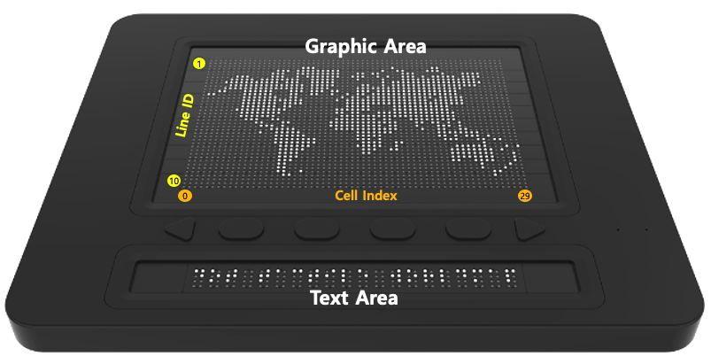

# DotPad SDK Guide

> **License** — Sample code and docs: [Apache-2.0](LICENSE). SDK binaries and headers: [DotPad SDK License Agreement](LICENSE-SDK.md) (not Apache-2.0). Bundled open source: [THIRD-PARTY-NOTICES.md](THIRD-PARTY-NOTICES.md). See [License](#license) for details.
>
> **라이선스** — 샘플 코드·문서: [Apache-2.0](LICENSE). SDK 바이너리·헤더: [DotPad SDK 이용약관](LICENSE-SDK.md)(Apache 아님). 포함된 오픈소스: [THIRD-PARTY-NOTICES.md](THIRD-PARTY-NOTICES.md). 자세한 내용은 [License](#license) 참고.

## Overview
* Dot Pad is a tactile display for the visually impaired that can express both text and graphics using Braille.
* The Dot Pad is divided into an area for printing text and Braille and an area for displaying graphics.
* Dot Pad is capable of data communication using Bluetooth BLE and USB C.
* You can develop applications for DotPad through the DotPad SDK.  
  <br>

## Directory
```
├── Android
│   ├── 1.1.0
│   ├── 2.0.0
│   ├── 3.0.0
│   ├── 3.0.1
│   ├── 3.0.2
│   ├── 3.0.3
├── iOS
│   ├── 1.2.0
│   ├── 2.0.0
│   ├── 2.1.0
│   ├── 2.2.0
│   ├── 2.3.0
│   ├── 2.3.1
│   ├── 2.3.2
├── Linux
│   ├── 1.0.0
├── Web
│   ├── 1.0.0
│   ├── 3.0.0
│   ├── 3.0.1
│   ├── 3.0.2
│   ├── 3.0.3
├── Windows
│   ├── 20cell-1.0.12
│   ├── 20cell-1.0.13
│   ├── 1.0.0
│   ├── 1.1.0
│   ├── 1.2.0
│   ├── 1.3.0
│   ├── 1.4.0
│   ├── 3.0.0
│   ├── 3.0.1
│   ├── 3.0.2
```
## Sample code using DotPad SDK
* You can test connecting to dotpad and printing by running the sample code.

## License
This repository contains material under different license terms.

| Component | License |
|---|---|
| Sample code (`*/DemoApp/`, except the SDK and third-party files copied into it), documentation and images | [Apache License 2.0](LICENSE) |
| DotPad SDK binaries (`.dll`, `.aar`, `.xcframework`, `.framework`, `.a`, SDK `.js`), header and type definition files, including copies inside `*/DemoApp/` | [DotPad SDK License Agreement](LICENSE-SDK.md) |
| Third-party components bundled with the SDK (liblouis, MeCab, IPAdic, BluetoothKit, ...) | Their own licenses — see [THIRD-PARTY-NOTICES.md](THIRD-PARTY-NOTICES.md) and [LICENSES](LICENSES) |

* The DotPad SDK is free to use, including in commercial applications, and may be redistributed unmodified as part of your application.
* "Dot" and "Dot Pad" are trademarks of Dot Incorporation. These licenses do not grant permission to use them, except to state compatibility (e.g. "Works with Dot Pad").

### 라이선스 (한국어)
* 샘플 코드·문서·이미지: [Apache License 2.0](LICENSE). 상업용 앱을 포함해 자유롭게 사용·수정할 수 있습니다. 단, `DemoApp/` 안에 복사해 둔 SDK 바이너리와 서드파티 파일은 아래 각 라이선스를 따릅니다.
* SDK 바이너리·헤더: [DotPad SDK 이용약관](LICENSE-SDK.md). 무료로 사용할 수 있으며, 수정하지 않은 상태로 본인 애플리케이션에 포함해 재배포할 수 있습니다.
* SDK에 포함된 오픈소스 구성요소는 각자의 라이선스를 따릅니다. [THIRD-PARTY-NOTICES.md](THIRD-PARTY-NOTICES.md)를 참고하세요.
